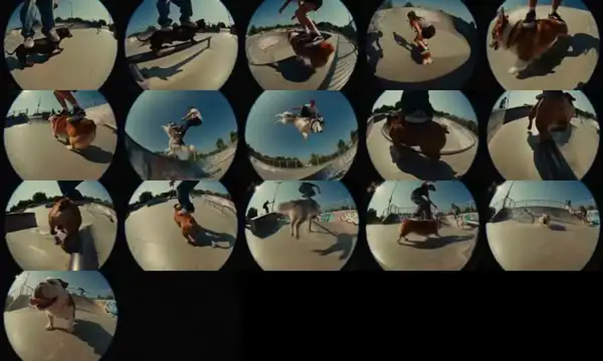

# Mapa — "People skateboarding on dogs" (formato #skateondog)

- **Fonte:** https://youtu.be/HBW7txQoL5w ("International AI Viral Clips", 16 s). É um repost em compilação do formato da hashtag **#skateondog** do TikTok, que inspirou o canal. O perfil original ainda não foi identificado: a página da hashtag só abre com login.
- **Como foi mapeado:** o YouTube bloqueou o download do vídeo a partir do servidor, então a análise usa as 16 miniaturas oficiais da linha do tempo (1 por segundo). Não há áudio nem transcrição.
- **Mapeado em:** 2026-10-20

## Storyboard (1 quadro ≈ 1 s)

| # | O que se vê | Câmera |
|---|---|---|
| 1 | Pés de skatista "remando" em cima de um dachshund preto, no chão da pista | Rente ao chão, olho de peixe |
| 2 | Skatista desliza num corrimão com o dachshund servindo de shape | Rente ao chão, ao lado do corrimão |
| 3 | Manobra na borda da pista em cima de um cachorro caramelo | Contra-plongée, olho de peixe |
| 4 | Garota anda "de cachorro" pela pista, vista de cima | Plano aberto, olho de peixe |
| 5 | Corgi em movimento com os tênis do skatista em cima dele | Rente ao chão, bem perto |
| 6 | Bulldog marrom com o skatista em cima, entrando na rampa | Rente ao chão |
| 7 | Salto alto com um cachorro branco e peludo, céu azul ao fundo | Contra-plongée forte |
| 8 | O mesmo salto no ápice, cachorro "voando" de lado | Contra-plongée, céu ocupando o quadro |
| 9 | Pousa na borda (coping) em cima do bulldog | Atrás, rente ao chão |
| 10 | Corrimão de cima para baixo com o bulldog | De cima, olho de peixe |
| 11 | Bulldog desliza no corrimão com o skatista | Rente ao chão |
| 12 | Grind no corrimão, close no bulldog e no tênis | Bem perto |
| 13 | Cachorro grande, bege, em movimento rápido (borrado) com o skatista saltando | Plano médio, pichações ao fundo |
| 14 | Bulldog anda pela pista com o skatista em pé em cima | Plano médio |
| 15 | Plano aberto da pista, um cachorro ao longe | Plano geral |
| 16 | **Final:** close do bulldog encarando a lente, com cara de satisfeito | Rente ao chão, olho de peixe |

## O que faz funcionar

1. **Uma troca absurda, repetida:** o shape do skate vira um cachorro. Não tem história nem fala; o absurdo se explica no primeiro segundo.
2. **Linguagem visual reconhecível:** imita vídeo de skate dos anos 90 (lente olho de peixe, vinheta circular, câmera rente ao chão, sol forte e cor quente de filme). O espectador reconhece o gênero na hora, e o contraste com o cachorro faz a piada.
3. **Montagem rápida:** um corte por segundo, 16 planos. Cada geração de IA só precisa render 1 segundo bom; os defeitos ficam escondidos pelo ritmo.
4. **Variedade dentro da regra:** cachorros e manobras diferentes a cada plano, sempre a mesma lógica.
5. **Final com o animal encarando a lente:** fecha o vídeo com "personalidade" e dá vontade de rever.
6. **Câmera baixa e o humano cortado:** o humano aparece só dos joelhos para baixo. O protagonista é o animal.

## O que levar para a Cleide

- **Ter uma "linguagem visual" própria e fixa**, e não só a câmera de celular genérica. Opções:
  - **(a)** flagra de celular vertical (o que está na BIBLIA hoje): realista, mas genérico;
  - **(b)** **câmera de segurança / CFTV**, com data e hora no canto, plano de cima, preto e branco ou cor lavada (ex.: a Cleide entrando na loja, no caixa eletrônico, no elevador). É muito reconhecível e muito barata de gerar bem;
  - **(c)** **reportagem de TV local** (repórter com microfone entrevistando o feirante sobre a galinha de calça), uma linguagem bem brasileira de "jornal do meio-dia".
- **Montagem rápida** de 10 a 16 planos de 1 a 1,5 s sobre um só tema (ex.: "a Cleide no forró": o pé dela no salão, a saia rodando ao lado, a calça no meio da quadrilha), aproveitando só o melhor segundo de cada geração do Veo.
- **Assinatura de final:** a Cleide ciscando direto na lente, em close, no fim de todo vídeo.
- **Uma troca absurda por episódio**, sem precisar de história: a calça é a troca fixa; o lugar muda.
